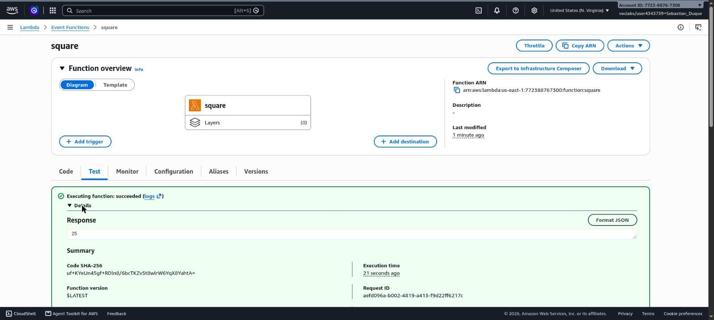
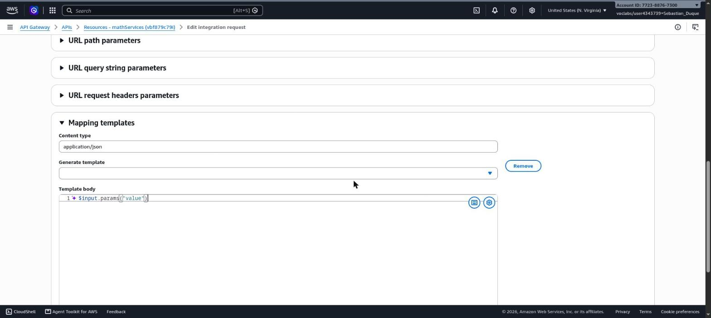
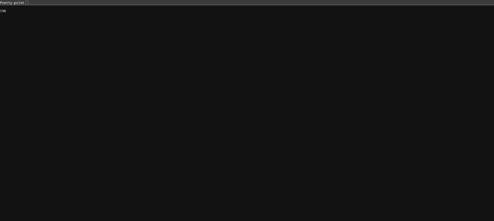
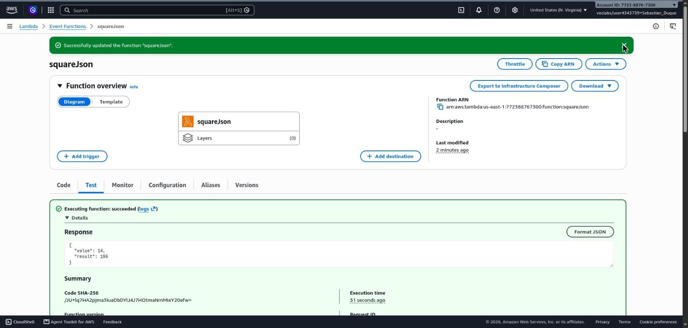

# Microservicio de cuadrado con AWS Lambda y API Gateway

Taller de TDSE. La idea es exponer como servicio REST una función en Java que
recibe un entero y devuelve su cuadrado. La función corre en AWS Lambda y se
publica a internet con API Gateway.

## Estructura

```
.
├── pom.xml
└── src
    ├── main/java/co/edu/escuelaing/services
    │   ├── MathServices.java
    │   ├── SquareRequest.java
    │   └── SquareResponse.java
    └── test/java/co/edu/escuelaing/services/MathServicesTest.java
```

`MathServices` tiene dos métodos que se usan como handler:

- `square(Integer)`: la versión del taller, recibe y devuelve un número.
- `squareJson(SquareRequest)`: recibe y devuelve objetos (POJOs), para la
  parte de entradas y salidas más complejas.

Ninguno tiene dependencias de AWS porque Lambda puede invocar directamente un
método estático y se encarga de convertir la entrada al tipo del parámetro.

## Compilar

Requiere Java 21 y Maven.

```bash
mvn package
```

Esto corre las pruebas y deja el jar en `target/math-services-1.0-SNAPSHOT.jar`,
que es el que se sube a Lambda.

> El enunciado pide Java 8, pero AWS ya no deja crear funciones nuevas con ese
> runtime, así que usé `java21`. El código es el mismo.

## Despliegue en AWS

### 1. Función Lambda

- Nombre: `square`
- Runtime: Java 21
- Rol: `LabRole` (cuenta de AWS Academy)
- Handler: `co.edu.escuelaing.services.MathServices::square`

Se sube el jar desde *Code > Update > Update from a .zip or .jar file*. Para probarla
creé un evento de prueba `testSquare` cuyo contenido es solo el número `5`
(no un JSON), y la respuesta fue `25`.



### 2. API Gateway

1. REST API nueva llamada `mathServices`, tipo de endpoint *Regional*.
2. Método `GET` sobre `/` con integración Lambda hacia `square`.
3. En *URL query string parameters* del método se agrega `value` (queda en *Method request*).
4. En *Integration Request* se mapea `value` a `method.request.querystring.value`.
5. Mapping template para `application/json`. Primero puse una constante
   (`7`) para comprobar que la integración funcionaba; desde la pestaña *Test*
   del método la respuesta siempre era `49`. Después la cambié por:

   ```
   $input.params("value")
   ```



Probando otra vez con `value=6` la respuesta fue `36`. Si se prueba sin el
parámetro `value`, a Lambda le llega una entrada vacía y no la puede convertir a
`Integer`, entonces responde:

```json
{"errorMessage":"An error occurred during JSON parsing","errorType":"java.lang.RuntimeException","stackTrace":[]}
```

Ojo que API Gateway igual devuelve status 200 en ese caso, porque no se
configuró ningún mapeo de errores en *Integration response*.

### 3. Publicación

*Deploy API* con un stage nuevo llamado `Beta`. Con eso queda una URL como:

```
https://vbf879c79i.execute-api.us-east-1.amazonaws.com/Beta?value=14
```

que responde `196`. También se puede probar desde la terminal:

```bash
curl "https://vbf879c79i.execute-api.us-east-1.amazonaws.com/Beta?value=14"
```

La URL deja de funcionar cuando se borran los recursos o se cierra el
laboratorio.



## Entradas y salidas con JSON

En la primera parte la función recibe un número suelto, y por eso hizo falta el
mapping template para sacar `value` del query string. Lo normal en un servicio
real es mandar y recibir objetos JSON, así que agregué una segunda versión que
trabaja con POJOs:

```java
public static SquareResponse squareJson(SquareRequest request) {
    if (request == null || request.getValue() == null) {
        throw new IllegalArgumentException("The field 'value' is required");
    }
    Integer value = request.getValue();
    return new SquareResponse(value, square(value));
}
```

`SquareRequest` y `SquareResponse` son clases normales con constructor vacío,
getters y setters. Eso es lo que necesita Lambda para hacer la conversión sola:

1. Llega el cuerpo `{"value": 14}`.
2. Lambda ve que el parámetro del handler es `SquareRequest`, crea el objeto con
   el constructor vacío y llama `setValue(14)`.
3. El método devuelve un `SquareResponse` y Lambda lo pasa a JSON usando los
   getters: `{"value":14,"result":196}`.

### Despliegue

- Nueva función Lambda `squareJson`, mismo jar, Java 21 y `LabRole`.
- Handler: `co.edu.escuelaing.services.MathServices::squareJson`.
- Evento de prueba `testSquareJson` con `{"value": 14}`, que respondió
  `{"value": 14, "result": 196}`.



En el API `mathServices` creé el recurso `/json` con un método `POST`
integrado con `squareJson` y redesplegué el stage `Beta`. A diferencia del
`GET`, aquí **no hay mapping template**: el cuerpo de la petición ya es el JSON
que espera la función, así que API Gateway lo pasa tal cual.

```bash
curl -X POST "https://vbf879c79i.execute-api.us-east-1.amazonaws.com/Beta/json" \
     -H "Content-Type: application/json" \
     -d '{"value": 14}'
```

Resultados:

| Cuerpo enviado   | Respuesta                                    |
|------------------|----------------------------------------------|
| `{"value": 14}`  | `{"value":14,"result":196}`                  |
| `{"value": -3}`  | `{"value":-3,"result":9}`                    |
| `{}`             | `errorMessage: "The field 'value' is required"` |

Justo después de desplegar, las primeras llamadas a `/json` respondieron
`403 Missing Authentication Token`. Ese mensaje sale cuando la ruta todavía no
existe en el stage; al rato de propagarse el despliegue empezó a responder bien.

## Notas

- La entrada que recibe la función es lo que genere el mapping template (o el
  cuerpo tal cual si no hay template). Por eso el `GET` manda un número suelto y
  el `POST` manda un objeto.
- Además de tipos simples y POJOs propios, Lambda también acepta los eventos
  predefinidos de `aws-lambda-java-events` (por ejemplo `S3Event`). No los usé
  porque necesitan otro servicio, como un bucket de S3, que dispare la función.
- Al terminar hay que borrar las funciones y el API para no generar costos.
